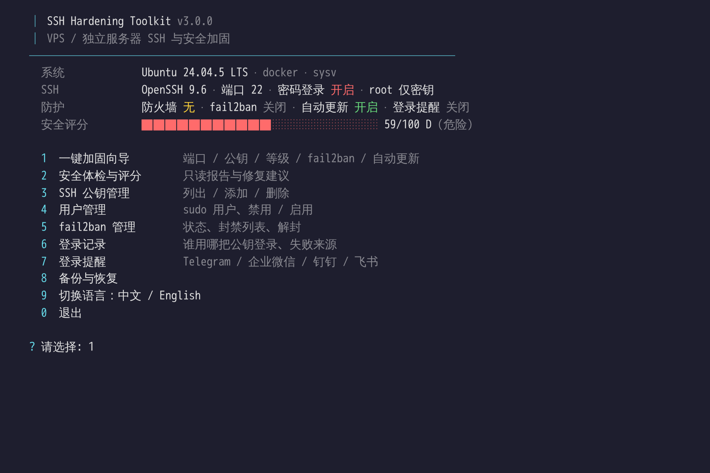
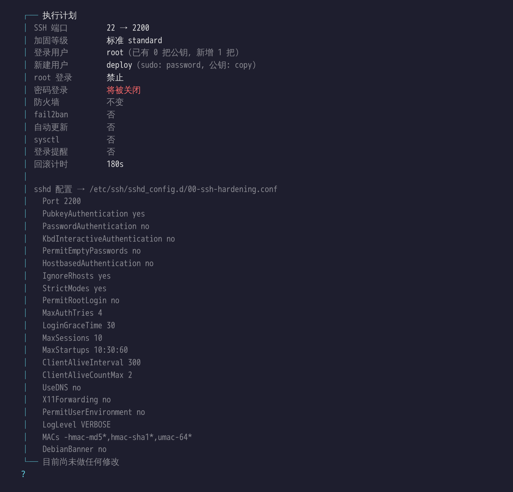
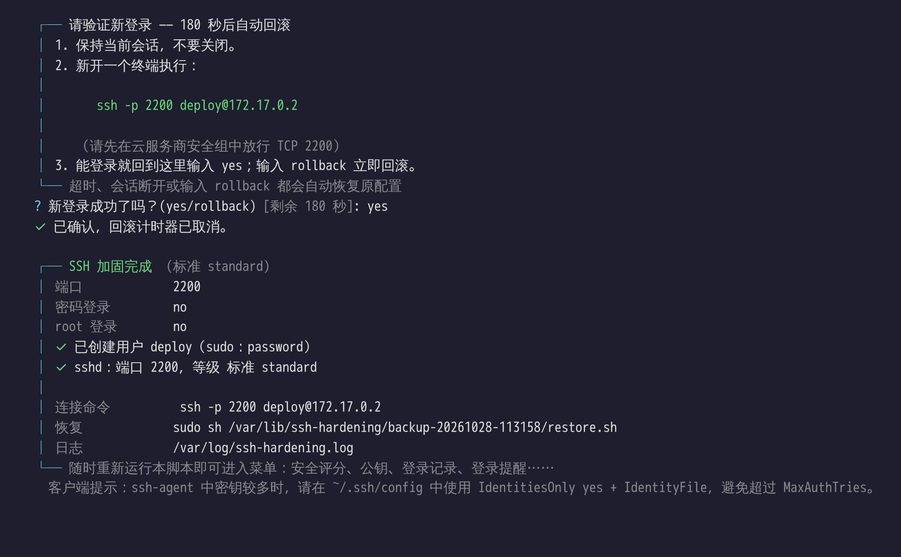

# ssh-key — VPS / 独立服务器 SSH 与基础安全加固

单文件 Bash 脚本，带中文交互菜单：把 SSH 改为**仅公钥登录**、迁移到自定义端口（默认 **54271**），并提供安全评分体检、公钥 / 用户 / fail2ban 管理、登录记录、登录提醒推送（Telegram / 企业微信 / 钉钉 / 飞书）、备份恢复，以及可选的自动安全更新、内核/网络 sysctl 加固和重启检查。全程有防锁死保护：分阶段应用、`sshd -T` 生效校验、端口监听校验，以及**未确认新登录则自动回滚**的倒计时。



## 主菜单

不带参数运行 `sudo bash main.sh` 即进入主菜单，顶部实时显示系统、SSH、防护状态和安全评分：

| 菜单 | 功能 | 命令行直达 |
| --- | --- | --- |
| 1 一键加固向导 | 6 步向导：端口 → 用户与公钥 → 等级 → 账户与 root 登录 → 附加防护 → 确认计划，然后两阶段应用 + 倒计时确认 | `--wizard` |
| 2 安全体检与评分 | 约 20 项检查（SSH 实际生效配置、弱公钥、空密码、UID 0、防火墙、fail2ban、自动更新、内核参数、待重启），给出 0–100 分、A–D 等级和改进建议；只读 | `--audit` |
| 3 SSH 公钥管理 | 按用户列出公钥（类型 / 位数 / 指纹 / 备注），标出**当前会话正在使用的公钥**和弱公钥；添加（粘贴或 `gh:用户名`）、删除（删除前自动备份，删光最后一把会强烈警告） | `--keys` |
| 4 用户管理 | 用户列表（sudo / 公钥数 / 密码状态）；新建 sudo 用户、授予/撤销 sudo、禁用/启用账户（账户过期，连公钥也无法登录）、设置密码；拒绝修改 root 和你自己 | `--users` |
| 5 fail2ban 管理 | 未安装时一键安装；查看失败次数与封禁列表，解封 / 封禁 IP（拒绝封禁你自己的 IP） | `--fail2ban-status` |
| 6 登录记录 | 最近 7 天成功登录：时间、用户、来源、方式、**使用的是哪把公钥**（按指纹对应到公钥备注）；失败尝试总数与来源 IP 排行；当前在线 | `--logins` |
| 7 登录提醒 | 每次 SSH 登录推送到 Telegram / 企业微信 / 钉钉 / 飞书 / 自定义 Webhook；先发测试消息，成功才启用 | `--notify` |
| 8 备份与恢复 | 列出每次运行的备份并可任选恢复；清理旧备份时**始终保留最初的原始备份** | `--backups` / `--restore` |
| 9 切换语言 | 中文 / English，选择会被记住 | `--lang zh\|en` |

## 支持的系统

| 系列 | 发行版（按 `/etc/os-release` 识别，未知发行版按包管理器回退） | 包管理 |
| --- | --- | --- |
| Debian | Debian、Ubuntu、Linux Mint、Kali、Deepin、UOS、Raspbian | apt |
| RHEL | RHEL、CentOS 7/Stream、Rocky、AlmaLinux、Oracle Linux、Fedora、Amazon Linux 2/2023、openEuler、Anolis、Alibaba Cloud Linux、OpenCloudOS、TencentOS、Kylin | dnf / yum |
| Alpine | Alpine（需先 `apk add bash`） | apk |
| Arch | Arch、Manjaro、EndeavourOS | pacman |
| SUSE | openSUSE Leap / Tumbleweed（含 `/usr/etc` vendor 配置）、SLES | zypper |
| Gentoo | Gentoo | — |

服务管理：systemd（含 Ubuntu 22.10+ 的 `ssh.socket` 套接字激活）、OpenRC、SysV、runit。虚拟化：KVM/物理机正常运行；OpenVZ/LXC 容器型 VPS 会自动跳过 sysctl；Docker 中仅做 SSH 部分。

## 快速开始

```bash
# 推荐：先下载、检查，再执行
curl -fsSL https://raw.githubusercontent.com/Banezzz/ssh-key/main/main.sh -o main.sh
sudo bash main.sh --audit      # 只读体检，不做任何修改
sudo bash main.sh              # 交互式加固

# 一行式（脚本会自动从 /dev/tty 读取交互输入，无需再加 </dev/tty）
curl -fsSL https://raw.githubusercontent.com/Banezzz/ssh-key/main/main.sh | sudo bash
```

向导流程：端口（回车用 54271，输入 `r` 随机选一个空闲端口）→ 登录用户 → 公钥（可粘贴，或输入 `gh:<GitHub用户名>` 导入）→ 加固等级 →（可选）创建 sudo 用户 → root 登录策略 / AllowUsers → 附加模块（含登录提醒）→ **显示完整计划后确认** → 执行 → 在新终端验证登录并输入 `yes` →（standard/strict）重启提示。

确认计划之前**不会修改任何文件**；`--dry-run` 会走完全部问题并打印将写入的配置后退出。

| 执行计划 | 验证新登录与完成 |
| --- | --- |
|  |  |

### 界面语言与终端兼容

- 默认中文；`--lang en` 或环境变量 `SSH_HARDEN_LANG=en` 切换英文，菜单 9 的选择会保存。
- 在无法显示中文的 Linux 本地控制台（`TERM=linux`，如部分 VNC 控制台）自动使用英文和 ASCII 符号；也可设置 `SSH_HARDEN_ASCII=1` 强制 ASCII，`NO_COLOR=1` 关闭颜色。
- 界面不依赖右侧边框对齐，在把制表符/方块字符按双宽显示的终端（Xshell、FinalShell、iTerm2 的“歧义宽度按双宽”选项）中也不会错位。

## 加固等级

| 等级 | 内容 |
| --- | --- |
| **basic** | 仅公钥登录；关闭密码、keyboard-interactive、空密码、hostbased；自定义端口 |
| **standard**（推荐） | basic + root 仅允许密钥或完全禁止（有 sudo 用户时默认禁止）、`MaxAuthTries 4`、`LoginGraceTime 30`、`MaxStartups`、空闲探测、关闭 X11、`LogLevel VERBOSE`（记录登录所用公钥指纹）、移除 SHA-1/umac-64 MAC、隐藏 Debian 版本横幅；可选 AllowUsers；默认启用 fail2ban、自动安全更新、sysctl |
| **strict** | standard + `PermitRootLogin no`（必须有非 root 的 SSH 用户）、关闭 TCP/agent/stream-local 转发与隧道、仅现代算法（按本机 OpenSSH 实际支持自动筛选，含 `sntrup761`/`mlkem768` 抗量子 KEX）、仅 Ed25519/RSA 主机密钥、禁用 DSA 主机密钥、移除 < 3072 位 DH moduli、`RekeyLimit` |

> strict 会让 **VS Code Remote-SSH、`ssh -L/-D` 隧道、agent 转发** 失效，这是预期行为。

生成的配置写入 `/etc/ssh/sshd_config.d/00-ssh-hardening.conf`（主配置有 `Include` 时）或主配置**顶部**的受管块（无 `Include` 的老系统）。sshd 对大多数指令是"首个值生效"，因此两种方式都能压过 `50-cloud-init.conf` 等其它来源；与之冲突的旧指令会被注释为 `# [ssh-hardening] ...`，`Port` 这类可叠加的指令会在所有文件中注释掉。

## 防锁死机制

1. **预检**：当前配置必须能通过 `sshd -t`；拒绝 DSA 与 < 2048 位 RSA 公钥（OpenSSH 7.0+ 默认不接受 DSA，会导致锁死）；检查 `AuthorizedKeysFile` 是否真的读取 `~/.ssh/authorized_keys`、账号是否被锁（无 PAM 时被锁账号连密钥也无法登录，常见于 Alpine）、shell 是否为 nologin、现有 `AllowUsers/DenyUsers` 是否排除目标用户、新端口是否被其它服务占用。
2. **SELinux**（RHEL 系）：自动 `semanage port -a -t ssh_port_t`，否则 sshd 无法绑定新端口。
3. **防火墙**：检测 ufw / firewalld / iptables / nftables 并放行新端口（在切换之前）。云厂商安全组无法检测，需要你自己放行。
4. **阶段 1**：新旧端口同时监听，确认新端口确实在监听（读取 `/proc/net/tcp`）。
5. **阶段 2**：写入最终配置 → `sshd -t` → `sshd -T` 校验实际生效值（端口、密码登录、root 登录等），被其它配置覆盖则视为失败 → 重启 → 再次确认监听。
6. **倒计时确认**（默认 180 秒）：在**新终端**用新端口登录成功后输入 `yes`。超时、输入 `rollback`、或当前会话断开，都会自动恢复原配置（后台独立进程执行，不依赖当前会话存活）。
7. 任何一步失败、Ctrl+C、SIGHUP 都会触发恢复。

每次运行的备份在 `/var/lib/ssh-hardening/backup-<时间>/`，其中的 `restore.sh` 可以随时手动执行；或使用 `sudo bash main.sh --restore`。日志：`/var/log/ssh-hardening.log`。

## 附加模块

| 模块 | 说明 |
| --- | --- |
| fail2ban | 为新端口配置 sshd jail（递增封禁时长、白名单当前客户端 IP）；自动选择 `backend`（无 auth.log 时用 systemd journal）与 `banaction`（firewalld / ufw / nftables / iptables）；RHEL 系会询问是否启用 EPEL |
| 自动安全更新 | Debian/Ubuntu: unattended-upgrades；RHEL 8+/Fedora: dnf-automatic（仅安全更新，CentOS Stream 无安全公告则用 default）；EL7/AL2: yum-cron；SUSE: 每日 `zypper patch --category security` 定时器。Arch/Alpine/Gentoo 不做无人值守升级 |
| sysctl | SYN cookies、禁止 ICMP 重定向/源路由、`kptr_restrict`、`dmesg_restrict`、`ptrace_scope`、受保护硬/软链接等；strict 另加 `log_martians`、禁止非特权 BPF、`bpf_jit_harden` 等。只写入内核支持的键。**不改动** `ip_forward` 与 `rp_filter`（Docker/VPN/路由主机依赖它们） |
| 端口保留 | 若 SSH 端口位于临时端口范围（默认 54271 就在 32768–60999 内），自动加入 `net.ipv4.ip_local_reserved_ports`，避免出站连接占用该端口导致 sshd 重启后无法绑定 |

## 登录提醒

菜单 7（或 `--notify`）配置，每次 SSH 登录推送一条消息，例如：`[SSH 登录提醒] 用户 deploy 登录了 web-01，来源 203.0.113.7，时间 2026-10-28 11:16:25 CST`。

| 渠道 | 需要填写 | 说明 |
| --- | --- | --- |
| Telegram | Bot Token（@BotFather）+ Chat ID | 中国大陆服务器通常无法访问 `api.telegram.org` |
| 企业微信机器人 | Webhook 地址 | 群机器人 |
| 钉钉机器人 | Webhook 地址 | 安全设置里添加关键词 `SSH` |
| 飞书 / Lark 机器人 | Webhook 地址 | |
| 自定义 Webhook | URL | POST JSON：`{"text","user","host","from"}` |

实现方式：在 `/etc/pam.d/sshd` 追加一行 `session optional pam_exec.so quiet /usr/local/sbin/ssh-hardening-notify`。`optional` 保证提醒脚本出错**永远不会阻止登录**，消息在后台发送，不会拖慢登录。配置保存在 `/etc/ssh-hardening/notify.conf`（权限 600）。需要 sshd 启用 PAM（`UsePAM yes`，主流发行版默认开启；Alpine 需安装 `openssh-server-pam`）。配置时会先发送测试消息，发送成功才会启用。

## 关于重启

修改 SSH、防火墙、sysctl **都是即时生效的，本身不需要重启**。脚本在结束时：

- 检测是否**真的需要**重启：`/var/run/reboot-required`（Debian/Ubuntu）、`needs-restarting -r`（RHEL）、`zypper needs-rebooting`、运行中的内核已被升级移除；
- standard / strict 等级会提示是否重启，并说明原因——即使没有待生效的更新，也建议趁还有控制台（VNC）访问时重启一次，验证 sshd、防火墙规则和 sysctl 在开机后都能正确恢复（例如未持久化的 iptables 规则在重启后会丢失）；
- 默认答案为 **No**；只在新登录确认成功后才建议重启；Docker 容器内不提示；`--reboot` / `--no-reboot` 用于无人值守。

## 命令行参数

```text
功能模式（不带参数时进入主菜单）
      --wizard             直接进入一键加固向导
      --audit              安全体检与评分（只读）
      --keys               SSH 公钥管理
      --users              用户管理
      --logins             登录记录与失败来源统计
      --fail2ban-status    fail2ban 管理
      --notify             登录提醒
      --backups            备份管理
      --restore [DIR]      从最近一次（或指定）备份恢复 SSH 配置
      --dry-run            走完向导并显示计划，不做任何修改
      --lang zh|en         界面语言

SSH
  -p, --port N             SSH 端口（默认 54271；22 或 1024–65535）
  -l, --level L            basic | standard | strict
  -u, --user NAME          登录用户（管理其 authorized_keys）
  -k, --key "PUBKEY"       添加公钥（可重复）；"gh:NAME" 导入 github.com/NAME.keys
      --key-file FILE      从文件添加公钥（可重复）
      --new-user NAME      同时创建 sudo 用户（复制相同公钥）
      --root-login MODE    no | prohibit-password（standard 等级）
      --allow-users / --no-allow-users
  -c, --config PATH        sshd_config 路径（默认 /etc/ssh/sshd_config）

安全
      --confirm-timeout S  新登录确认时限，超时自动回滚（默认 180，0 关闭）
      --self-test          额外执行 ssh -p PORT user@localhost 自测（需要本机有私钥）

附加模块（不指定则询问；standard/strict 默认开启）
      --firewall / --no-firewall
      --fail2ban / --no-fail2ban
      --auto-updates / --no-auto-updates
      --sysctl / --no-sysctl
      --reboot / --no-reboot

  -y, --yes                非交互：全部使用默认值（需要提供公钥来源）
```

旧的位置参数仍然兼容：`sudo bash main.sh 60022 /etc/ssh/sshd_config`。

### 无人值守示例（cloud-init / 批量部署）

```bash
sudo bash main.sh --yes -p 2222 -l standard -u deploy -k gh:your-github-name \
  --fail2ban --auto-updates --sysctl --no-reboot
```

`--yes` 模式没有人工确认环节（倒计时回滚关闭），请确保公钥正确；建议加 `--self-test`（若本机有对应私钥）或先用 `--dry-run` 检查。`--yes` 下新建用户默认使用 NOPASSWD sudo（无法非交互地设置密码），root 登录默认保持 `prohibit-password`，除非显式传入 `--root-login no`。

## 注意事项

- **云安全组**（阿里云、腾讯云、AWS、GCP 等）必须自行放行新端口，脚本无法检测。
- 在**确认新终端可以登录之前**不要关闭当前会话。
- 客户端 ssh-agent 中密钥较多时，请在 `~/.ssh/config` 中使用 `IdentitiesOnly yes` + `IdentityFile`，否则可能在尝试到正确密钥前就耗尽 `MaxAuthTries`。
- RHEL 8 的 crypto-policies 通过命令行参数传给 sshd，会覆盖 strict 设置的算法列表；如需更严格，可执行 `update-crypto-policies --set FUTURE`。
- 恢复只回滚 SSH 配置；已放行的防火墙规则、SELinux 端口标签、已创建的用户与已安装的软件包会保留。
- 公钥管理删除公钥前会备份到 `/var/lib/ssh-hardening/keys-backup/`；“当前会话”标记依赖 `LogLevel VERBOSE`（standard / strict 等级会开启）。
